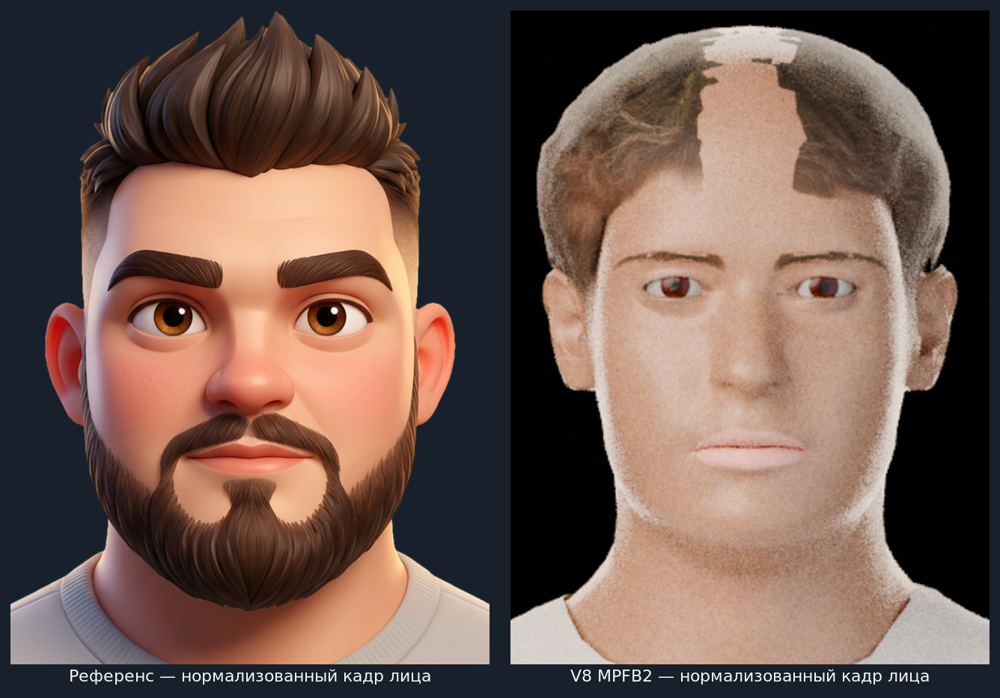
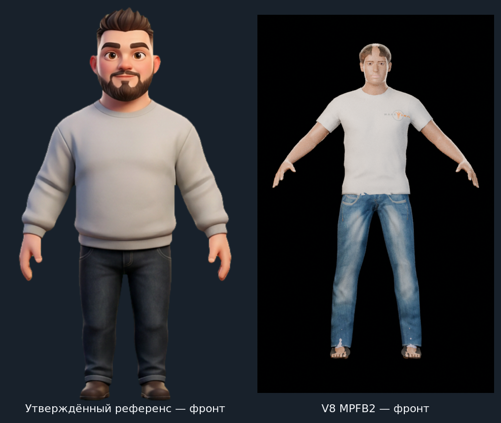

# V8 — промежуточная проверка MPFB2 (НЕ УТВЕРЖДЁН)

**Статус: НЕ УТВЕРЖДЁН.** MPFB2 зарегистрирован и действительно работает в Blender WASM; геометрия и targets применены, рендеры получены. Но текущий образ пока не является Dad: нет бороды, волосы имеют заметные дефекты, форма лица ещё уже и глаже референса, а одежда — короткорукавная футболка вместо свитера. Dad и общий renderer остаются неутверждёнными.

## Референс рядом с V8

Нормализованное сравнение лица: верхняя часть головы и межзрачковая линия приведены к сопоставимому масштабу. Сравнение сделано по фактическим изображениям, а не по описанию ассетов.

Полный фронт: поза и кадрирование всё ещё различаются; в V8 видны T-pose, футболка и неудачно подогнанная обувь.

Дополнительные текущие ракурсы: [фронт](front.png) · [три четверти](three-quarter.png) · [профиль](profile.png) · [крупный план](face-closeup.png).

## Результат по шагам исходного задания

| Шаг | Проверенный результат | Статус |
|---|---|---|
| 1. Установить MPFB2 в Blender WASM, создать базового персонажа через API и проверить голову/глаза/веки | MPFB2 v2.0.18 загружен в Blender 5.2.0 WASM; базовая сетка `Human` создана через MPFB2 API. В текущую сцену импортирован fitted proxy глаз с коричневой радужкой. Через `TargetService` применены targets масштаба, раскрытия и положения глаз; геометрия рендерится Cycles в WASM. | **Технически выполнено** |
| 2. Возраст 30–35, немного плотнее, округлые щёки, шире челюсть, skin material | Начальные макронастройки: `gender=1.0`, `age=0.55`, `muscle=0.5`, `weight=0.60`, `proportions=0.60`, `height=0.50`, Caucasian `1.0`. Дополнительно применены `maxweight=0.12`, щёки `0.42/0.42`, `head-fat=0.18`, `chin-width=0.28`. Назначен MPFB layered skin material с входным цветом `(0.50, 0.28, 0.18)`. Значение `age=0.55` — коэффициент морфологии MPFB, не доказательство возраста 30–35; рендер всё ещё бледнее и уже референса. | **Частично; возраст и likeness не подтверждены** |
| 3. Короткие волосы и полная тёмно-коричневая борода | На модели протестированы настоящие CC0 hair proxies `short01`–`short04`. У `short01/02` виден scalp-gap, `short03` закрывает глаз, `short04` слишком короткий/почти buzz cut. `short02` — лучший из просмотренных, но заметный пробел по центру лба остаётся. В проверенных наборах MPFB2/HumanGenWeb beard/moustache proxy нет; текущая сцена без бороды. | **Не выполнено** |
| 4. Светло-серый crewneck-свитер и джинсы | Протестированы реальные CC0 варианты одежды `male_casualsuit01`, `02`, `03`, `06`. `06` — короткорукавная футболка с эмблемой MakeHuman; её верхняя часть затонирована в светло-серый, но это не свитер и логотип виден. Джинсы присутствуют. Shoes proxies `03/04` оставляют пальцы открытыми и не соответствуют обуви референса. | **Частично; точной одежды и обуви нет** |
| 5. Фронт, 3/4, профиль, close-up и REVIEW_V8 | Получены все четыре диагностических рендера. Созданы два визуальных side-by-side board и этот отчёт с измерениями, оценкой и параметрами следующей коррекции. | **Выполнено как проверка, не как приёмка** |

WASM не оказался препятствием, поэтому Plan B (внешний OBJ/GLB) **не запускался**.

## Измерение глаз относительно референса

Ирисы выделены по коричневым пикселям в одном и том же исходном изображении каждого портрета. Координаты ниже указаны в пикселях оригиналов; сами пиксельные расстояния нельзя напрямую сравнивать из-за разного разрешения/масштаба.

| Измерение | Референс | V8 | Вывод |
|---|---:|---:|---|
| Центры радужек | `(336, 438)`, `(567, 440)` | `(273, 225)`, `(365, 225)` | V8 симметричен по высоте после MPFB targets; координаты требуют нормализации по лицу. |
| Межзрачковое расстояние | `231 px` | `92 px` | Приблизительно нормировано на ширину лица: `0.40` у референса против `0.34` у V8; у V8 глаза остаются примерно на 10–15% ближе друг к другу. |
| Видимая ширина глаза относительно ширины лица | около `0.18` | около `0.15` | V8-глаза всё ещё маловаты; увеличить размер примерно на 15–20%, затем повторить overlay-проверку. |
| Высота глазной линии в пределах головы | около `0.50` | около `0.49` | Вертикальное положение сейчас близкое; `trans-down=0.18` не увеличивать без новой проверки. |

Применённые парные значения MPFB2: `eye-scale=0.65`, `eye-height1=0.30`, `eye-trans-down=0.18`, `eye-trans-out=0.14`. Следующий тест: масштаб около `0.80–0.90`, `trans-out` около `0.22–0.28`; выбирать значение только после нового наложения, не по одному рендеру. Нулевые дубли shape keys `.001`, оставшиеся от повторного запуска probe, выключены (`value=0`).

## Оценка лица и следующие параметры

- **Щёки:** текущие `l/r-cheek-volume=0.42` уже применены через MPFB2, но нормализованное сравнение показывает более узкую и плоскую среднюю часть лица. Следующий контролируемый тест: `0.60–0.70` симметрично.
- **Челюсть/подбородок:** `chin-width=0.28` дал лишь небольшое расширение; нижняя часть всё ещё уже референса. Проверить `0.38–0.45`, отдельно от увеличения щёк.
- **Объём головы:** `head-fat=0.18`; проверить `0.28–0.35`, следя за профилем и сохранением пропорций носа/подбородка.
- **Волосы:** проблема не в числовом оттенке, а в fit/покрытии scalp и несоответствии силуэта. Не называть short02 подходящей причёской: центральный пробел на лбу виден в крупном плане. Тест полностью opaque-текстуры ухудшил край, поэтому он отменён; текущий рендер использует исходную alpha-текстуру CC0.
- **Борода:** доступного лицевого hair asset не обнаружено. Ничего не подменялось неподтверждённой процедурной «бородой»; для следующего прохода нужен отдельный лицензированный asset либо предоставленный пользователем OBJ/GLB.
- **Возраст/телосложение:** возрастное значение `0.55` и max-weight target `0.12` пока только стартовые ориентиры. Не заявлять точный возраст 30–35 или утверждённую комплекцию по текущему рендеру.
- **Кожа:** shader назначен, но в текущем освещении кожа остаётся светлой/плоской; проверить входной цвет и свет/экспозицию совместно, не только менять один RGB.
- **Одежда:** `male_casualsuit06` — футболка, не длинный рукав и не вязаный crewneck; логотип виден. Джинсы подходят лишь как временный proxy. Обувные proxies `03/04` проверены на модели и признаны непригодными: пальцы остаются открытыми.
- **Кадр/поза:** макушка теперь видна в полном фронтальном кадре, но T-pose и чёрный фон не совпадают с референсом. Это диагностическая постановка, а не финальный рендер персонажа.

## Лицензии и runtime-совместимость

- Проверены прокси `short01`–`short04`, `eye`, `eyebrow001`, одежда и обувные assets из [`NastyFFM/HumanGenWeb`](https://github.com/NastyFFM/HumanGenWeb). README репозитория указывает, что mesh/targets — CC0 и происходят из MPFB2 и официального MakeHuman system-assets CC0 pack; в README перечислен источник pack: [`makehuman_system_assets_cc0.zip`](https://files.makehumancommunity.org/asset_packs/makehuman_system_assets/makehuman_system_assets_cc0.zip). Именно эти CC0 proxies тестировались. В MPFB2 есть metadata с названиями beard presets, но Hair Editor ожидает отдельно установленный `hair.blend`; такого pack в staged addon нет, а его отдельная лицензия и WASM-совместимость не проверены, поэтому preset не считался доступным beard asset.
- Лицензии MPFB2 разделяют код (GPLv3) и bundled assets (CC0); используемые targets взяты из upstream snapshot [`6ff1eb3`](https://github.com/makehumancommunity/mpfb2/tree/6ff1eb358f6c1959ced77e79e6dd2406d9a71f49). Новые eye scale/height/translation targets проверены в WASM через `TargetService`.
- Ранее проверенный AGPL hair asset из `dmaugis/makehuman-py3-assets` в текущей сцене **не используется** и не считается очищенным для распространения.
- Вывод о совместимости ограничен импортированными JSON/texture proxies и target files, перечисленными выше; он не подтверждает наличие или работу отсутствующего MPFB2 hair/beard `.blend` pack.

## Версионный аудит

| Версия | Метод | Итог относительно Dad |
|---|---|---|
| **V6** | Процедурный head/bust на базе official Human Base Mesh | Не одобрена: гладкая «шапка», борода читается как широкая маска, likeness слабый. См. [`V6 review`](../dad-head-study-v6/REVIEW.md). |
| **V7** | Процедурная геометрия с изменениями глаз/волос/бороды | Не одобрена: cap/helmet, beard patch, глаза не выверены по измеренному overlay. См. [`V7 review`](../dad-head-study-v7/REVIEW.md). |
| **V8** | MPFB2 API + реальные CC0 hair/eye/clothing proxies и MPFB2 morph targets | WASM/API работают; глаза теперь открыты и измерялись по референсу. Но бороды нет, лучший short hair имеет пробел, одежда не совпадает, cheeks/eye spacing требуют коррекции. Не одобрена. |

## Файлы этой проверки

- Самодостаточная сцена для технического осмотра: [`dad-head-study-v8-mpfb-unapproved.blend`](../../models/dad/studies/dad-head-study-v8-mpfb-unapproved.blend) (11 МБ; текстуры упакованы). Рабочая копия: `tools/blender-wasm-runtime/workspace/models/dad-head-study-v8-mpfb.blend`.
- Рендеры: `front.png`, `three-quarter.png`, `profile.png`, `face-closeup.png`.
- Side-by-side: `face-comparison-v8.png`, `front-comparison-v8.png`.

**Решение:** оставить V8 промежуточным и неутверждённым. До следующей оценки нужны пригодные лицензированные борода/волосы и длиннорукавный светло-серый свитер, затем повторить глазной overlay и четыре финальных ракурса. Общий renderer также остаётся диагностическим и не считается универсально проверенным.
