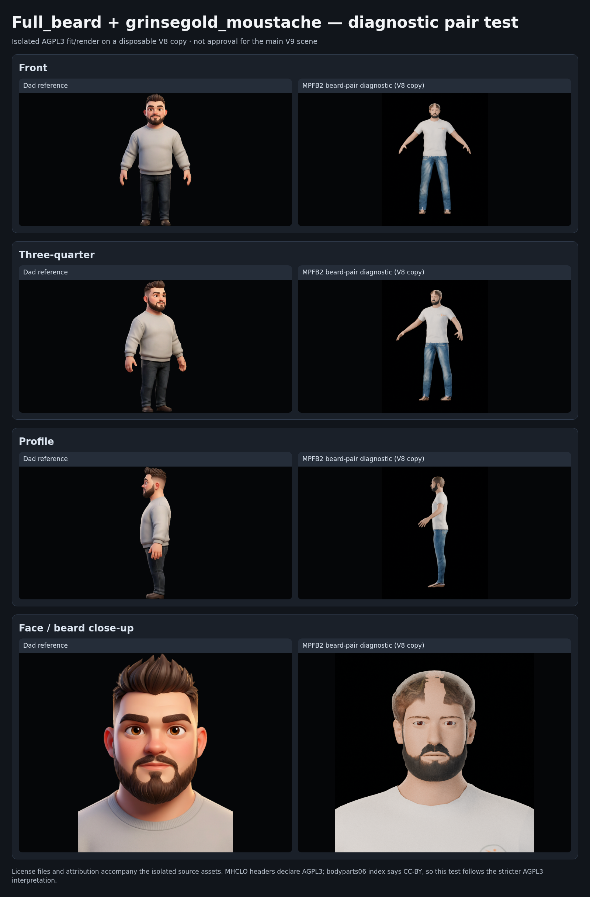

# V9 beard-pair probe — isolated AGPL3 diagnostic, not approved

**Date:** 2026-11-02.

**Decision scope:** the user explicitly authorized separate fit/render tests of `grinsegold_full_beard` and `grinsegold_moustache` under the stricter AGPL3 interpretation, with attribution and license materials. This is permission to test only; it does **not** approve either asset for the main V9 scene.

## Test setup and traceability

- Opened a disposable copy of `assets/models/dad/studies/dad-head-study-v8-mpfb-unapproved.blend` as `dad-beard-pair-agpl3-unapproved.blend`; the tracked V8 source file was not edited (SHA-256 unchanged: `08c541ba184ced8209ef41c6d8f0c654084824aa7fce6be061da1df246ff8544`).
- MPFB2 source snapshot: `makehumancommunity/mpfb2` commit `6ff1eb358f6c1959ced77e79e6dd2406d9a71f49`.
- Imported both MHCLOs with MPFB2 `HumanService.add_mhclo_asset(..., asset_type="Hair")`. This is a facial-hair proxy fit via the supported MHCLO path, not an assumed `Beard` API branch.
- `Human.full_beard`: **423 vertices / 374 polygons**. `Human.moustache`: **81 vertices / 60 polygons**. Both assets loaded and fitted successfully.
- The test body uses the documented simple Principled skin fallback `(0.50, 0.28, 0.18)`, roughness `0.62`, subsurface `0.035` to avoid the previous Cycles closure overflow. Beard materials use their RGBA diffuse maps; the supplied normal maps are retained with the source but not connected in this diagnostic shader.
- Cycles 48 samples. Front, three-quarter, profile and face close-up completed. The runtime emitted the known `Human.body` / `BodySectionsRouter` warning on load; no `Maximum number of closures exceeded` appeared during these renders. Eight resources were packed into the separate `.blend`.

## Visual assessment against Dad references

Separate raw renders: [Front](beard-pair-front.png) · [Three-quarter](beard-pair-three-quarter.png) · [Profile](beard-pair-profile.png) · [Face close-up](beard-pair-face-closeup.png).

The moustache is now visible and sits on the upper lip; in the tested front, 3/4 and profile views it meets the cheek beard without an obvious floating gap. The pair gives substantially better cheek and jaw coverage than the Elvs scruffy candidate and is the strongest real-asset beard candidate tested so far.

It is still **not a likeness approval**. The close-up shows a noticeable center seam in the moustache, a somewhat hard/angular moustache edge, and a dense, nearly continuous lower beard; the reference has softer hair breakup and a more shaped chin/goatee opening. The diagnostic uses diffuse-only beard shading, so strand/normal detail is understated. The comparison board also makes clear that the V8 base still differs in face width, eye expression/size, hairline, pose, shirt and footwear; those are outside this beard-pair test and must not be mistaken for V9 acceptance.

## License and attribution

Both downloaded MHCLO headers say `license AGPL3`, while the public bodyparts06 index lists both assets as CC-BY. The conflict remains unresolved. Following the user's instruction, this test conservatively treats both as AGPL-3.0-only and carries the full license text plus per-asset attribution and source files in [`assets/models/dad/diagnostics/beard-pair-agpl3/`](../../models/dad/diagnostics/beard-pair-agpl3/). Source snapshot: `RavinMaddHatter/Madhatters-Table-Top-RPG-Mini-Maker` commit `01e848fdb85cd270228027bf7e1bb8eb85ac47d4`.

## Status / next gate

The pair is technically compatible and visually promising enough to retain as an isolated candidate. It has **not** been merged into the main V9 scene, and the test `.blend` remains explicitly unapproved. Any later inclusion requires the user's visual approval and must retain the AGPL attribution/license materials. V8, the main V9 work and the shared renderer are unchanged by this probe.
