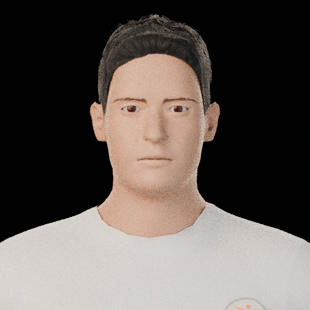
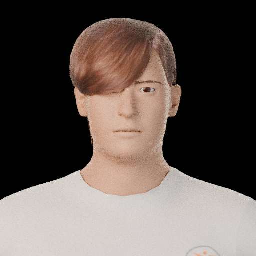
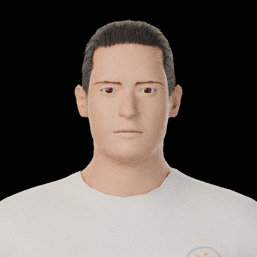
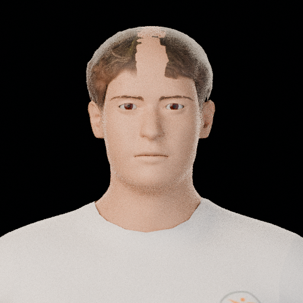
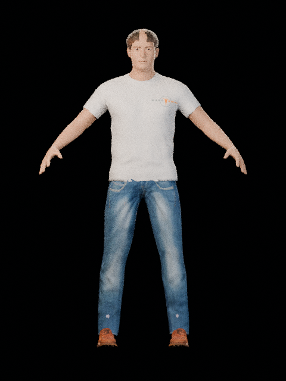
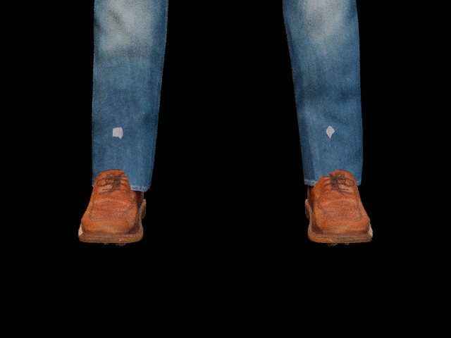

# V9 изолированная диагностика — промежуточный отчёт, НЕ утверждён

**Статус на 2026-11-02:** исходный `assets/models/dad/studies/dad-head-study-v8-mpfb-unapproved.blend` не изменён. Полный V9 `.blend` не создавался. Все новые изменения проверялись в отдельных временных копиях V8 в `tools/blender-wasm-runtime/workspace/models/`; они не являются утверждённой сценой. V8 и shared renderer остаются неутверждёнными.

Предыдущий материал/Cycles тест см. в [REVIEW_V9_MATERIAL_PROBE.md](../dad-head-study-v9-material-probe/REVIEW_V9_MATERIAL_PROBE.md).

## Итог по направлениям

| Область | Проверено | Решение на сейчас |
|---|---|---|
| MPFB2 missing textures / Cycles closure | Временная копия с восстановленными upstream JPEG; native Cycles close-up; временный Principled на `Human` | Ошибки отсутствующих изображений после восстановления исчезли, но `Maximum number of closures exceeded: 96 > 64` остаётся. Principled — только диагностический кандидат, не финальный материал. |
| Волосы | Реальные HumanGenWeb proxy `short01`, `short03`, `short04` против V8 `Short02`, корректно fitted к той же базе; front face close-ups | `short01` и `short04` закрывают большую часть bald patch на макушке; `short03` закрывает левый глаз и отвергнут. Ни один вариант пока не утверждён относительно референса. Hair Editor не запускался. |
| Борода | Проверены MPFB2 API и несколько открытых asset trees | Подходящий MHCLO не найден; специальная Beard-ветвь API не подтверждена. В сцену ничего не добавлялось. |
| Глаза / IPD | Прямое изменение отдельного `V8.CC0.Eyes` mesh на отдельных копиях | Варианты +12% и +15% между halves вместе с масштабом глаз 1.10 визуально меняют постановку; референсное совпадение ещё не установлено. |
| Одежда | Осмотрены proxy JSON и diffuse maps четырёх доступных кандидатов | Нет подтверждённого подходящего длиннорукавного casual/sweater ассета; ни один кандидат не переименовывался и не выдавался за свитер. |
| Обувь | HumanGenWeb `shoes01`, корректный fit к V8 базе, Cycles front и close-up | Диагностический результат убедительный: закрытая коричневая шнурованная пара. Можно перенести в отдельного V9 кандидата после решения остальных задач, но сама по себе обувь не оправдывает полный V9. |

## 1. MPFB2 textures и shader

В runtime восстановлены восемь JPEG из MPFB2 snapshot `6ff1eb358f6c1959ced77e79e6dd2406d9a71f49` в:

`tools/blender-wasm-runtime/workspace/addons/bl_ext/user_default/mpfb/data/textures/`

Файлы: `mpfb_eyelids.jpg`, `mpfb_aureolae.jpg`, `mpfb_face.jpg`, `mpfb_lips.jpg`, `mpfb_fingernails.jpg`, `mpfb_toenails.jpg`, `mpfb_ears.jpg`, `mpfb_genitals.jpg`. Это grayscale 2048×2048 карты разных регионов MPFB2, а не восемь взаимозаменяемых цветных skin/eye diffuse maps. Не утверждается, что каждый файл виден на крупном плане.

После восстановления missing-image ошибки исчезли в Cycles render на временной копии; closure warning сохранился. Проверен отдельный простой Principled на `Human` (Base Color `(0.50, 0.28, 0.18)`, Roughness `0.62`, Subsurface Weight `0.035`): он не вызвал прежнее closure warning, но был только диагностическим skin fallback и не утверждался как финальный.

## 2. Волосы: сравнение настоящих proxy assets

**Источник:** [HumanGenWeb README](https://github.com/NastyFFM/HumanGenWeb/blob/main/README.md) указывает, что приложение построено на MPFB2 mesh/targets; hair и другие asset packs берутся из MakeHuman CC0 pack. Hair Editor намеренно не применялся: необходимые отдельные `hair.blend`/`fur.blend` packs в этом runtime не подтверждены.

Проверены proxy-файлы и карты в `tools/blender-wasm-runtime/workspace/candidates/humangenweb/hair/`:

| Asset | Тип / данные | Рендерный результат |
|---|---|---|
| `short01.json` + `short01.webp` (RGBA; для Blender WASM создана локальная PNG-копия) | MHCLO-подобный fit/map/UV/quads proxy; 3,177 mapped vertices | Плотное короткое покрытие, закрывает прежний светлый bald patch; высокая передняя линия волос остаётся. Кандидат для дальнейшего сравнения. |
| `short02.json` + `short02.webp` | Текущий V8 `V8.CC0.Short02` — baseline | На лбу/макушке виден большой светлый пробел. Небольшие ручные сдвиги исходного объекта ранее ухудшили покрытие макушки. |
| `short03.json` + `short03.webp` (RGBA) | 1,071 mapped vertices | Чёлка закрывает часть левого глаза; отвергнут как неподходящий для этой сцены. |
| `short04.json` + `short04.webp` (RGBA) | 991 mapped vertices | Более короткое текстурированное покрытие закрывает bald patch; верх выглядит более колючим/жёстким, чем `short01`. Не утверждён. |

WebP карты конвертированы в PNG только для теста: сборка Blender WASM сообщала `unknown file-format` для WebP. Proxy был fitted с оригинальным 19,158-vertex MPFB2 HM08 topology; это не простое переименование объектов. В кадрах ниже для отделения формы волос от проблемы skin shader использовался временный простой Principled на теле.

| V8 baseline `Short02` | HumanGenWeb `short01` | HumanGenWeb `short03` | HumanGenWeb `short04` |
|---|---|---|---|
|  |  |  |  |

Вывод ограничен фронтальными крупными планами: `short01`/`short04` устраняют центральный верхний пробел в этой тестовой сцене, но выбор по референсу, 3/4 и profile fit ещё не сделан. Это не финальные ракурсы персонажа.

## 3. Борода и API

V8 не содержит бороды. Проверенный `HumanService.add_mhclo_asset` принимает строковый `asset_type`, но в просмотренной реализации MPFB2 не обнаружена подтверждённая специальная Beard pipeline/ветвь. Поиск по HumanGenWeb, `frankyaye/communityassets`, `communityassets-wip`, старым community trees и `mpfb-eye-model-v2` не дал подходящего beard MHCLO. Ничего не импортировалось и визуальный успех не заявляется.

## 4. IPD и размер глаз

`V8.CC0.Eyes` — отдельный неприпарентованный mesh: targets у `Human` сами по себе не перемещают его геометрию. На изолированной копии изменялся именно mesh: центры половин приблизительно `X=-0.031018` и `X=+0.030752`, исходный разнос `0.061770`; варианты +12% и +15% по межцентровому расстоянию сочетались с масштабом обеих половин `1.10`.

Пиксельная оценка по одинаковому close-up: baseline около 77 px, +12% около 86 px (~+11.7%), +15% около 88 px (~+14.3%). Это диагностический прирост, а не утверждение, что глаза попали в референс.

 · [IPD +12% / scale 1.10](eye-ipd-plus12.png) · [IPD +15% / scale 1.10](eye-ipd-plus15.png)

## 5. Одежда: кандидаты не подходят

Текстуры в `tools/blender-wasm-runtime/workspace/candidates/humangenweb/` визуально проверены; JSON-файлы содержат proxy fit data, а не готовую одежду для ручного переименования.

| Имя | Файлы / тип | Проверенный вид | Решение |
|---|---|---|---|
| `male_elegantsuit01` | `.json` proxy + `.webp` diffuse | Формальный костюм/куртка, белый воротник, галстук | Не подходит вместо простого свитера. |
| `male_worksuit01` | `.json` proxy + `.webp` diffuse + `_normal.webp` | Синий комбинезон | Не подходит. |
| `male_casualsuit04` | `.json` proxy + `.webp` diffuse | Безрукавный верх с джинсами | Не подходит: открытые руки. |
| `male_casualsuit05` | `.json` proxy + `.webp` diffuse | Жилет с джинсами | Не подходит: открытые руки. |

Проверенного длиннорукавного casual/sweater варианта пока нет; одежда V8 не подменялась этими активами.

## 6. Закрытая обувь: HumanGenWeb `shoes01`

Исходные файлы в `tools/blender-wasm-runtime/workspace/candidates/humangenweb/`: `shoes01.json` (proxy), `shoes01.webp` (albedo), `shoes01_normal.webp` (normal). WebP в текущем Blender WASM не читался (`unknown file-format`); для диагностического рендера карты перекодированы в `shoes01.png` и `shoes01_normal.png`. Источник HumanGenWeb указывает на MakeHuman CC0 asset pack.

Первая попытка импортировать shoes01 упала с `IndexError`: код брал evaluated mesh (13,380 вершин), а proxy ссылается на исходную 19,158-vertex topology и индексы до 17,745. Исправление использовало исходный `Basis` плюс относительные shape-key deltas. Для fit также учтены единицы и оси: HumanGenWeb хранит HM08 в decimetres/Y-up, V8 Blender mesh — metres/Z-up. После преобразования базовые координаты совпали с HumanGenWeb `mesh.bin` (19,158 вершин; максимальная ошибка по осям порядка `3e-7`); вычисленные proxy scales `[0.9986, 0.9970, 0.9984]`. Финальный диагностический render показывает пару закрытых коричневых шнурованных туфель поверх стоп — в отличие от тестового V8 `shoes04`, где видны пальцы.

Это результат временного обувного probe, не сохранённый `.blend` и не полная оценка кандидата-персонажа. Cycles: Front 480×640 / 16 samples; shoe close-up 640×480 / 16 samples.

| V8 текущие `shoes04` | HumanGenWeb `shoes01` — Front | `shoes01` — close-up |
|---|---|---|
|  |  |  |

## Отклонённые / неудачные попытки

- Первый shoes01 fit по `evaluated_get(...).to_mesh()` — `IndexError`, поскольку topology не совпадала по числу вершин; исправлено чтением исходной Basis.
- Первый fit по Blender координатам без HM decimetre/Y-up преобразования дал обувь неправильного масштаба/положения; это была ошибка import-probe, а не доказательство несовместимости JSON. Корректное преобразование дало scales около 1 и визуально закрытые туфли.
- WebP в Blender WASM не читается; для пробных материалов использованы локальные PNG-конверсии.
- MHCLO-кандидат `topboots` из `frankyaye/communityassets` не импортировался: README называет его CC0, но заголовок `topboots.mhclo` указывает AGPL3, а README предупреждает о грязной/несовершенной геометрии. Из-за противоречивых license metadata он исключён из текущего теста.
- Позиционные сдвиги существующего `V8.CC0.Short02` вперёд/вниз ухудшали покрытие макушки; вместо них теперь сравнивались реальные hair proxies.

## Решение и следующий шаг

Есть содержательные hair, eye, shoe и facial-hair пробы, но выбор по референсу ещё не означает одобрение персонажа. Полнофигурная сцена V8 и все отдельные V9 probes остаются диагностическими; сам V8 source, approval status и shared renderer не менялись. Следующий шаг — пользовательская оценка бородной пары; только после визуального одобрения можно отдельно решать, допустима ли интеграция в основной V9.

## 7. Борода + усы: отдельный AGPL3 fit/render probe (2026-11-02)

Пользователь разрешил отдельную проверку `grinsegold_full_beard` и затем `grinsegold_moustache` по строгой AGPL3 трактовке, с атрибуцией и лицензионными материалами. Оба MHCLO header указывают `license AGPL3`, тогда как bodyparts06 index указывает CC-BY; конфликт metadata остаётся неразрешённым, поэтому обе проверки консервативно сопровождаются AGPL-3.0-only текстом и источниками.

Оба MHCLO успешно fitted через `HumanService.add_mhclo_asset(..., asset_type="Hair")` к **отдельной копии V8**, не к исходному файлу. Результат: `Full_beard` — 423 vertices / 374 polygons; `grinsegold_moustache` — 81 / 60. Cycles 48 samples: Front, Three-quarter, Profile и Face close-up завершились; отдельный `.blend` хранит packed textures. На старте повторяется runtime warning `Human.body` / `BodySectionsRouter`; `Maximum number of closures exceeded` в этих рендерах не появлялся. В diagnostic shader применены diffuse RGBA maps, normal maps оставлены в source bundle, но не подключались.

Подробный visual review и side-by-side с Dad reference crops: [`REVIEW_V9_BEARD_PAIR_AGPL3.md`](REVIEW_V9_BEARD_PAIR_AGPL3.md). Усы видны и на проверенных ракурсах не имеют очевидного floating gap к щёчной бороде. Это лучший проверенный реальный beard candidate на данный момент, но он не принят: в close-up заметен центральный шов moustache, край жёсткий/угловатый, нижняя борода плотнее/непрерывнее Dad reference. Pair остаётся **отдельным unapproved diagnostic**, не включён в основной V9.

Исходные MHCLO/OBJ/MHMAT/textures, attribution и AGPL text: [`assets/models/dad/diagnostics/beard-pair-agpl3/`](../../models/dad/diagnostics/beard-pair-agpl3/).
