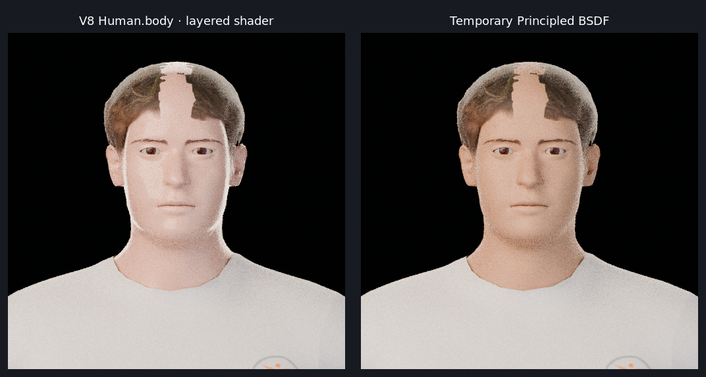

# V9 material / renderer probe — НЕ УТВЕРЖДЁН

**Статус: только диагностический тест; V8 и общий renderer остаются неутверждёнными.** Проверена отдельная рабочая копия `dad-head-study-v8-mpfb-unapproved.blend`; исходная V8-сцена, её рендеры и отчёт не перезаписывались. Новый полный V9-персонаж или `.blend` не создавался.

## Эксперимент

Один и тот же ракурс `V8_MPF_FACE_CLOSEUP`, 512 × 512, 24 samples, Blender 5.2.0 WASM, native Cycles:

1. **Baseline:** исходный материал `Human.body` с MPFB2 layered shader.
2. **Контроль:** изменён только material slot 0 у объекта `Human`: временный узел Principled BSDF, Base Color `(0.50, 0.28, 0.18)`, Roughness `0.62`, Subsurface Weight `0.035`. Геометрия, камера, свет и остальные материалы оставлены прежними.

Отдельные исходные PNG: [layered baseline](face-closeup-layered-baseline.png) · [simple Principled](face-closeup-simple-principled.png).

## Фактические результаты

| Проверка | Результат |
|---|---|
| Исходный V8 material в Cycles | Рендер **успешен** (40.48 s). Во время построения шейдера Cycles сообщил `Maximum number of closures exceeded: 96 > 64`; также сообщил об отсутствующих MPFB2 image-файлах и `Failed to load 8 image files`. |
| Временный простой Principled на `Human` в Cycles | Рендер **успешен** (17.05 s). В логах после замены не появилось повторного `96 > 64`; кожа стала визуально теплее и ровнее, но это не исправило форму лица или другие проблемы. Разница во времени не считается чистым бенчмарком: исходный рендер был первым, холодным запуском Cycles. |
| `BodySectionsRouter` | При открытии сцены WASM/Three exporter выдал `Human.body: its shader mix is not drawn; its shader mix passes through group BodySectionsRouter`. Это предупреждение о неподдержанном shader mix в **Three.js-представлении**, а не отказ native Cycles: Cycles после него действительно отрендерил V8. После замены body-материала предупреждение для этого объекта не появилось. |
| Видимый дефект волос | Большой светлый пробел на лбу сохранился почти неизменным на обоих изображениях. Следовательно, этот дефект не объясняется `BodySectionsRouter` или skin shader; это проблема покрытия/посадки hair mesh. Бороды в сцене по-прежнему нет. |
| EEVEE / Workbench | **Нативная совместимость не установлена.** В этом runtime EEVEE и Workbench заменены обёрткой `VOLTER_THREE`; вызов render через эту обёртку требует Three-фотографию, которой headless-проба не предоставляет. `nativePreview()` явно создаёт копию сцены и принудительно ставит `CYCLES`. Поэтому неудачный запуск через обёртку — не доказательство несовместимости MPFB-материала с настоящими EEVEE/Workbench. |

### Отсутствующие текстуры, зарегистрированные в логе Cycles

`mpfb_eyelids.jpg`, `mpfb_aureolae.jpg`, `mpfb_face.jpg`, `mpfb_lips.jpg`, `mpfb_fingernails.jpg`, `mpfb_toenails.jpg`, `mpfb_ears.jpg`, `mpfb_genitals.jpg` — runtime искал их в каталоге addon `.../mpfb/data/textures/`, где этих файлов не было. Это отдельный сигнал неполной поставки/упаковки MPFB2 shader resources. Не утверждается, что все восемь изображений видимы на данном крупном плане.

## Что это означает для рекомендаций V9

- **`asset_type`:** API `HumanService.add_mhclo_asset` принимает `asset_type` при загрузке именно MHCLO-ассета; значение записывается в metadata и участвует в классификации. В V8 во время этого теста уже загруженные CC0 proxy-меши (`V8.CC0.Short02`, `V8.CC0.Eyes` и др.) не загружались через `add_mhclo_asset`, поэтому смена этого аргумента не может исправить их текущий Cycles shader. `Hair` и `Eyes` — подходящие категории для соответствующих MHCLO-ассетов; `Beard` в проверенном API не документирован как отдельная специальная категория/ветвь обработки (метод принимает строку, но это само по себе не подтверждает поддержку beard asset pipeline). Для глаз тип материала задаётся отдельно, например `material_type="PROCEDURAL_EYES"`.
- **Простой Principled BSDF:** подтверждён как полезный изолированный диагностический fallback для тела: он устранил предупреждение о превышении closure в этом тестовом рендере и дал умеренно более тёплый цвет кожи. Это не готовый likeness-материал и не исправление пробела волос, отсутствующей бороды, пропорций либо одежды.
- **Упрощение shader:** оправдано исследовать дальше для материала `Human.body`, но нужно отдельно сохранить корректные участки кожи, губ, век и ногтей и проверить нужные текстуры. Этот тест заменил весь material slot 0, поэтому сам по себе не определяет, какие именно группы следует оставить.
- **EEVEE / Workbench:** повторить на настоящем Blender runtime, где эти native engines не подменены `VOLTER_THREE`; текущая WASM-проверка не отвечает на вопрос об их совместимости.
- **Orphan cleanup:** пока не применять как «исправление» shader warning. Очистка несвязанных datablocks сама по себе не упрощает активную node graph и не восстанавливает отсутствующие texture files.

## Вывод

`BodySectionsRouter` объясняет ограничение Three.js/browser-представления, но не блокирует native Cycles. Реальный Cycles closure warning возникает на текущем сложном MPFB2 body shader; замена только его на простой Principled позволила отрендерить сцену без повторения этого предупреждения. Это влияет на техническую надёжность/вид skin shader, но не объясняет главную видимую проблему волос: пробел на лбу остаётся, как остаются и остальные причины непринятия V8. **V8 остаётся НЕ УТВЕРЖДЁННЫМ; этот тест не является приёмкой V9 или shared renderer.**

## Источники API

- [MPFB2 `HumanService.add_mhclo_asset` на проверенном snapshot](https://github.com/makehumancommunity/mpfb2/blob/6ff1eb358f6c1959ced77e79e6dd2406d9a71f49/src/mpfb/services/humanservice.py#L503)
- [MPFB2 HumanService documentation](https://github.com/makehumancommunity/mpfb2/blob/6ff1eb358f6c1959ced77e79e6dd2406d9a71f49/docs/services/humanservice.md)
