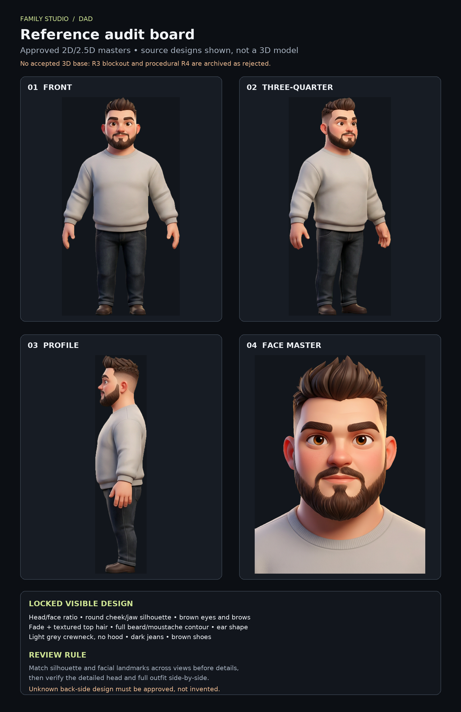

# Dad — reference audit for the next 3D model

Status: preparation document; **no 3D geometry is approved**. R3 blockout and procedural R4 v1 are archived rejects. This audit is a guide for a new custom model, not a substitute for side-by-side visual approval.

The board is a derived contact sheet: source images are only uniformly fit inside labeled panels; no master artwork or character geometry was edited.

## Locked sources

Use only these unchanged local master files as the primary design references:

- `assets/references/character-masters/characters/dad/turnaround.png` — front / three-quarter / side on a chroma-green background; use the figure only, never sample the green as a material.
- `assets/references/character-masters/characters/dad/front.png` — separate full-body front.
- `assets/references/character-masters/characters/dad/three_quarter.png` — separate three-quarter view.
- `assets/references/character-masters/characters/dad/side.png` — separate side view.
- `assets/references/character-masters/characters/dad/face.png` — face close-up for facial landmarks, hairline, beard contour, skin, and eye details.
- `assets/references/character-masters/characters/dad/character.json` — palette and identity metadata. Its `height_heads: 5.9` and normalized `art.face` coordinates are guides, not a surveyed 3D measurement. The file is immutable; the light crewneck/no-hood decision is a separate user override.

## Measured silhouette data

I extracted **934 image-space outer-silhouette samples** from the untouched `front.png`, `three_quarter.png` and `side.png` alpha channels (alpha ≥128, every 2 px). CSV and source-hash manifest:

- [`dad-silhouette-profiles.csv`](../../assets/references/character-masters/characters/dad/derived/dad-silhouette-profiles.csv)
- [`dad-silhouette-profiles.manifest.json`](../../assets/references/character-masters/characters/dad/derived/dad-silhouette-profiles.manifest.json)
- Reproducible utility: [`tools/reference-audit/`](../../tools/reference-audit/README.md)

This is a measured constraint set, **not a model**. It only stores image-space outer bounds; transparent gaps inside a silhouette are collapsed. The three-quarter view is for visual cross-checking, not an orthographic depth profile. World scale and unseen surfaces remain unresolved until explicitly reviewed.

## Visual fidelity checklist

| Priority | Reference feature to preserve | Required check |
|---|---|---|
| P0 — identity | Head-to-body ratio; broad shoulder line; torso narrowing toward the waist; recognizable round face and strong jaw | Same scale and camera framing; compare front and three-quarter silhouette before showing a model |
| P0 — face | Eye spacing and shape, non-bulging placement, eyelids, warm brown irises, thick expressive brows, nose profile, smile/mouth, ears, cheeks | Front + three-quarter + profile overlays; close-up must match master without camera/light tricks |
| P0 — hair/beard | Short faded sides, raised textured top and its direction; full beard/moustache silhouette, cheek line and chin volume | Compare the hairline/beard outline at all available angles; visible hair/beard must read as volume, not a flat decal |
| P0 — sweater silhouette | Light grey crewneck without a hood; rounded ribbed neck, cuffs and hem; soft volume and folds | Sleeves descend naturally from shoulders, bend and taper toward cuffs; torso is shaped cloth, not a box |
| P1 — trousers/shoes | Dark jeans with hip, thigh and knee volume, seams/folds, brown low shoes matching the master | Front/profile/three-quarter; check knee and ankle silhouettes, not only front-color blocks |
| P1 — surface/lookdev | Skin, hair, fabric, denim and shoe colors; soft controlled highlights consistent with the stylized reference | Neutral studio light and a separate beauty pass; presentation must not conceal shape errors |
| P2 — unseen design | Back of head, rear garment construction, hidden seams and unseen topology | Mark unknown; obtain author direction before turning an inference into canon |

## Defect-to-correction map from the user's critique

| Reported defect | Modeling correction | Acceptance evidence |
|---|---|---|
| Head too small; torso boxy/flat | Re-establish head/body proportion and torso silhouette from reference measurements; do not inherit either rejected mesh | Front and three-quarter silhouette overlay |
| Sweater rigid like a box; sleeves like tubes | Sculpt/model the garment as shaped cloth over the body; articulate shoulder-to-elbow-to-cuff taper and soft folds | Neutral front / three-quarter / profile plus elbow bend |
| Jeans lose hip and knee volume | Build the leg forms first, then garment volume and folds over hips/thighs/knees | Front/profile silhouette and simple pose test |
| Eyes protrude / look startled | Seat eyes within shaped sockets; model eyelids and brow masses; tune globe exposure against face master | Neutral face close-up, not just beauty render |
| Beard appears glued on | Build a volumetric beard mass with a reference-matched cheek/chin silhouette and integrated moustache; layer clumps/groom only after mass is right | Front/profile close-ups under neutral light |
| Render reads like an unfinished test | Use clean camera, framing, color management, soft key/fill/rim and finished materials only after geometry is credible | Separate geometry review and final lookdev board |

## Как учитывать будущие корректировки и изображения

- Новые изображения от пользователя/других ИИ сначала считаются **предложениями**, а не автоматической заменой утверждённых master files.
- Для каждой картинки фиксировать intended change (например, только форма рукава, только нос, новый ракурс) и проверять, не противоречит ли она уже locked features.
- Если новая картинка конфликтует с face/beard/hairline/ear locks, не смешивать источники молча: зафиксировать различие и следовать прямому решению пользователя о том, что теперь канон.
- PNG-рендеры каждой итерации должны иметь номер версии и одинаковые camera/scale; так пользователь сможет корректировать конкретный defect, а не весь результат абстрактно.

## Review gates

1. **Reference lock:** align source crops by eye centers, nose base, mouth, chin, hairline, shoulder line, waist and feet. Record any crop/perspective mismatch rather than silently warping a master.
2. **Head gate:** create a custom head study with the visible identity features already represented; inspect front / three-quarter / profile and face close-up against the masters. Do not submit a generic gray primitive blockout as the result.
3. **Clothing/body gate:** after head approval, transfer the body silhouette and draped crewneck/jeans/shoes, then review the same orthographic views.
4. **Lookdev gate:** neutral clay and material views must both pass. A polished render cannot compensate for geometry mismatch.
5. **Production gate:** only after design approval proceed to retopology/UV, materials, rig, pose and motion tests.

## Review device and modeling tools

The user reviews the work on an **iPhone**. Keep review artifacts as phone-friendly PNGs; do not make the user install Blender or operate a desktop UI just to approve a model. The `.blend` remains a source deliverable for later opening on a computer, not a blocker to visual feedback.

The current sandbox has a headless Blender WebAssembly runtime but no interactive Sculpt UI. The old primitive/blockout workflow is closed. We can still run real Blender Python/Cycles from this environment, but future geometry must be custom and reference-measured, not generated from generic primitive assemblies. Every presented pass must be a real Blender scene/render with the matching source views; internal rough studies are not acceptance deliverables and cannot be called professional without user review.

A candidate browser route is Puter's experimental full Blender WebAssembly/WebGPU app: <https://developer.puter.com/labs/blender-web/> with source at <https://github.com/HeyPuter/blender-wasm>. WebKit documents WebGPU support in Safari on iOS 26: <https://webkit.org/blog/17333/webkit-features-in-safari-26-0/>. This makes an iPhone test plausible, but the app's interface, memory needs, touch controls and `.blend` save/load have not been validated on the user's device. A web inspection from this sandbox reported no WebGPU adapter; that is not a test of the user's iPhone. Treat the route as optional, not required for the user to review progress.

No paid cloud service is required or presumed. Continue with local Blender WASM for controlled scene generation and PNG review while clearly disclosing that it is not interactive manual sculpting.
